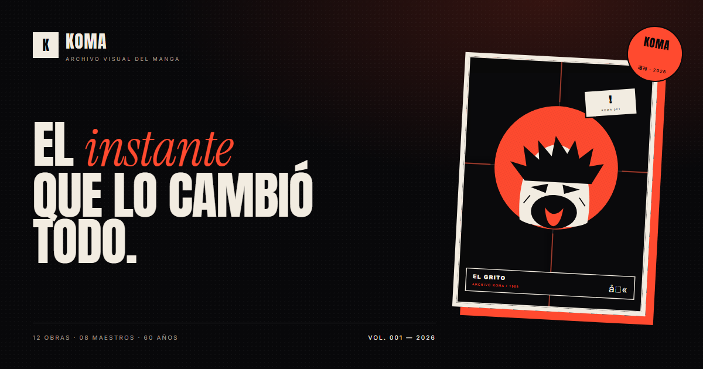

# KOMA — Boilerplate editorial con flexbox

Archivo visual de paneles icónicos del manga. Un *boilerplate* de una sola página
construido con HTML semántico, CSS propio y flexbox como sistema de layout.



---

## Cómo abrirlo

1. Descarga o clona la carpeta.
2. Abre `index.html` en el navegador (doble clic).
3. Para servirla en local:

   ```bash
   py -m http.server 8080
   ```

   y visita `http://localhost:8080`.

No requiere build, npm ni frameworks. Las tipografías y los iconos se cargan por
CDN, así que la primera visita necesita conexión.

---

## Estructura

```
INTERFACESWEB/
├── index.html                 Documento único
├── css/
│   ├── reset.css              Reset propio (Normalize-style)
│   └── style.css              Diseño, componentes y responsive
├── assets/
│   └── img/
│       ├── panels/            Imágenes reales usadas en la página
│       │   ├── hisoka.jpg       Hunter × Hunter
│       │   ├── bunny.jpg        Blue Lock
│       │   ├── law-corazon.jpg  One Piece
│       │   ├── levi.jpg         Attack on Titan
│       │   ├── ippo.jpg         Hajime no Ippo
│       │   ├── murasakibara.jpg Kuroko no Basket
│       │   ├── nagi.jpg         Blue Lock
│       │   ├── shidou.jpg       Blue Lock
│       │   ├── adan.jpg         Record of Ragnarok
│       │   ├── tesla.jpg        Record of Ragnarok
│       │   ├── mudano.jpg       Tougen Anki
│       │   └── mori.jpg         Kokou no Hito (The Climber)
│       ├── panel-01.svg … panel-08.svg   Láminas SVG originales (legado)
│       ├── favicon.svg
│       └── og-cover.png       Imagen social 1200 × 630
├── imagenes/                  Carpeta original aportada por el usuario
├── design.md                  Especificación estética para agentes IA
├── README.md
└── tools/
    ├── generate-panels.ps1    Generador de las láminas SVG
    ├── og-cover.html          Fuente de la portada social
    └── contact.html           Contact sheet de las láminas
```

---

## Qué incluye

- **Header sticky** con marca, navegación y CTA.
- **Menú desplegable CSS puro** (hover + `focus-within`) inspirado en
  *css3-menu-generator*, con versión móvil de checkbox + hamburguesa.
- **Hero editorial** con dos imágenes reales superpuestas, sello circular y kanji vertical.
- **Cinta tipográfica** infinita con las obras del archivo.
- **Cifras**, **panel de la semana**, **ficha técnica** y **aside sticky**.
- **Archivo de 9 artículos repetidos** con filtros CSS (`:has()`), sin JavaScript.
- **Línea de tiempo**, **manifiesto**, **newsletter** y **footer** con redes.
- **Botón fijo** en la esquina inferior derecha.
- **Responsive** de 390 a 2000 px, con `prefers-reduced-motion`.
- **SEO**: metas principales, Open Graph, Twitter Card, canonical y JSON-LD.
- **Accesibilidad**: skip link, foco visible, alt en todas las imágenes,
  jerarquía de encabezados, labels y estados de foco.

---

## Correspondencia con la consigna

| Requisito | Dónde se cumple |
|---|---|
| Un HTML y un CSS propios | `index.html` + `css/style.css` |
| Normalización o reset propio | `css/reset.css` (13 reglas base) |
| Estructura semántica inicial | `header`, `nav`, `main`, `section`, `article`, `aside`, `footer` |
| Metas principales | `charset`, `viewport`, `description`, `keywords`, `author`, `robots`, `theme-color`, OG, Twitter, canonical |
| DIVs de 1000–2000 px tipo Apple | `--w-narrow: 1000px`, `--w-base: 1280px`, `--w-wide: 1600px`, `--w-hero: 1760px` |
| Flexbox como pilar | Header, hero, cifras, destacado, tarjetas, timeline, footer |
| Imágenes con `alt` | 12 imágenes en página (2 hero, 1 destacada, 9 tarjetas), 0 sin `alt` (verificado con headless Chrome) |
| Google Fonts + Font Awesome por CDN | `<head>` de `index.html` |
| Variables globales | `:root` en `css/style.css` (paleta, fuentes, anchos, movimiento) |
| `position` fijo abajo-derecha | `.to-top { position: fixed; right: 24px; bottom: 24px; }` |
| Unidades absolutas + relativas | px para layout; rem/em/% para tipografía e iconos |
| Especificación para agentes IA | `design.md` |
| Menú con interacciones | Dropdown CSS + menú móvil + script opcional de cierre |
| Footer con redes | 5 iconos de Font Awesome con `aria-label` |
| Contenido propio y artículos repetidos | 9 `<article class="card">` + timeline + manifiesto |

---

## Personalización rápida

### Cambiar el acento

```css
:root {
  --red: #ff4a2f;
  --red-deep: #c92a13;
}
```

### Cambiar la tipografía

1. Sustituye el `<link>` de Google Fonts en `index.html`.
2. Actualiza `--font-display`, `--font-serif` y `--font-body` en `:root`.

### Cambiar los anchos

```css
:root {
  --w-narrow: 1000px;
  --w-base: 1280px;
  --w-wide: 1600px;
  --w-hero: 1760px;
}
```

### Añadir un panel al archivo

1. Copia un `<article class="card">` y cambia `data-cat`, imagen, título, extracto
   y metadatos.
2. Añade la imagen en `assets/img/panels/` (o usa una existente).
3. Si creas una categoría nueva, añade su radio, su chip y su regla `:has()` en
   `css/style.css`, además de un `<span>` en el contador.

### Sustituir las imágenes

Las imágenes actuales son **paneles e ilustraciones reales** de las obras citadas,
aportadas en la carpeta `imagenes/` y optimizadas en `assets/img/panels/`. Para
cambiarlas:

1. Coloca el archivo original en `imagenes/`.
2. Genera una versión optimizada en `assets/img/panels/` (máx. 1000–1200 px,
   JPEG calidad 88–90) con tu editor o script de imágenes preferido.
3. Actualiza `src`, `alt`, `width` y `height` en la tarjeta o figura.
4. Añade la obra, el autor y el crédito correspondiente.

Las tarjetas recortan a 4:5 con `object-fit: cover`; el hero y el destacado
mantienen la proporción original. Evita ampliar imágenes de menos de 400 px.

---

## Notas

- **Antes de publicar:** sustituye `https://koma.example/` en `canonical`, `og:url`,
  `og:image` y `twitter:image`; conecta el formulario a tu proveedor de newsletter
  y reemplaza los enlaces `href="#"` de las tarjetas por las fichas reales.
- **Imágenes:** pertenecen a sus respectivos autores y editoriales. Se usan
  únicamente con fines educativos y sin ánimo de lucro. Antes de publicar el
  sitio, sustituye las imágenes por material licenciado o solicita permiso.
  `imagenes/riku.jpg` e `imagenes/images.jfif` no se usaron porque no se pudo
  verificar su serie; indícalo si quieres incorporarlas.
- **JavaScript:** el sitio funciona sin JS. El único script (10 líneas) cierra el
  menú móvil al navegar y con Escape; es una mejora progresiva.
- **Compatibilidad:** `:has()` (filtros), `aspect-ratio`, `100dvh` y
  `backdrop-filter` son estándar en navegadores actuales. Si `:has()` no está
  disponible, se muestran todas las tarjetas y los filtros siguen resaltándose.
- **Rendimiento:** JPEG optimizados (10–165 KB), `loading="lazy"` en tarjetas y
  `fetchpriority="high"` en las dos imágenes del hero.
- **Verificación:** se comprobó con Chrome headless a 2000, 1920, 1440, 960,
  760, 520 y 390 px: sin overflow horizontal, fuentes cargadas, 12 imágenes
  cargadas, 0 sin `alt`, filtros correctos (9 → 1/2/4/1/1:
  shonen/seinen/deportes/ciencia/sobrenatural) y botón fijo sin solaparse con
  los enlaces legales.

---

## Créditos

- Tipografías: [Anton](https://fonts.google.com/specimen/Anton),
  [Instrument Serif](https://fonts.google.com/specimen/Instrument+Serif) e
  [Inter](https://fonts.google.com/specimen/Inter) (Google Fonts).
- Iconos: [Font Awesome 6 Free](https://fontawesome.com/) vía cdnjs.
- Obras citadas: *Hunter × Hunter* (Yoshihiro Togashi), *Attack on Titan*
  (Hajime Isayama), *Hajime no Ippo* (George Morikawa), *Kuroko no Basket*
  (Tadatoshi Fujimaki), *Blue Lock* (Muneyuki Kaneshiro / Yusuke Nomura),
  *One Piece* (Eiichiro Oda), *Record of Ragnarok* (Shinya Umemura / Ajichika),
  *Tougen Anki* (Yura Urushibara) y *Kokou no Hito / The Climber* (Shinichi Sakamoto).
- Imágenes: © sus respectivos autores y editoriales; uso educativo.
- Dirección de arte y código: KOMA Studio.
- Inspiración: editorial japonés, revistas de arquitectura y la composición
  amplia de apple.com.

Hecho con tinta y flexbox.
